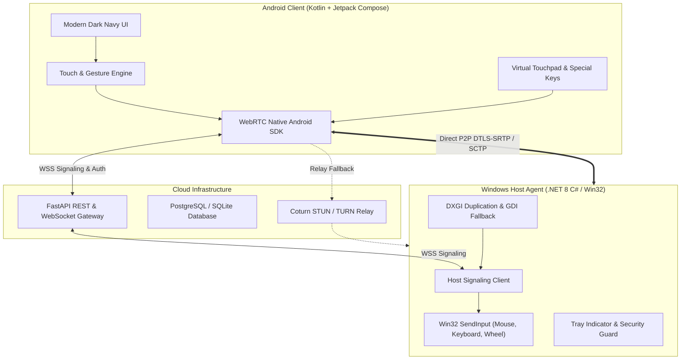

# RemoDesk: Remote Laptop Control System (Android to Windows)


-brightgreen)

RemoDesk is a modern, low-latency remote desktop system that lets you view and control your personal Windows 10/11 laptop from an Android smartphone over the internet from anywhere in the world.

---

## 1. System Architecture



---

## 2. Main Features

### A. Android Mobile Client
- **Authentication & Security**: Email/password registration with 6-digit email verification, password recovery & reset, refresh token rotation, secure encrypted storage (`EncryptedSharedPreferences`), and AndroidX Biometric authentication (Fingerprint & Face unlock).
- **Device Dashboard**: Real-time online/offline and session status, device renaming, remote access toggle switch, device deletion, and one-tap Connect.
- **Live Remote Desktop**: Live desktop video view with WebRTC peer-to-peer transport, aspect ratio fit/fill, touch zoom ($1.0\times$ to $4.0\times$), connection state indicators (`Connecting`, `Connected`, `Reconnecting`, `Paused`, `Disconnected`, `Failed`), and real-time latency HUD.
- **Touch & Gesture Engine**:
  - Single tap: Left click.
  - Double tap: Double click.
  - Long press (500ms): Right click (with haptic feedback).
  - Single-finger drag: Move cursor and drag windows.
  - Two-finger drag: Smooth mouse wheel scroll.
  - Two-finger pinch: Dynamic viewport zoom.
- **Virtual Touchpad Mode**: Relative trackpad motion with tactile Left & Right mouse buttons and adjustable sensitivity ($0.5\times$ to $3.0\times$).
- **On-Screen Keyboard & Special Keys**: Windows Key, Ctrl, Alt, Shift, Tab, Esc, Enter, Backspace, shortcuts (Win+D, Alt+Tab, Copy/Paste), and arbitrary text typing.
- **Remote File Manager**: Browse laptop folders in real time over WebSockets, download files chunk-by-chunk to the Android Downloads folder, upload files via Android system file picker with overwrite confirmation dialogs, and delete files with confirmation.
- **Clipboard Synchronization**: Two-way clipboard synchronization with strict 64KB UTF-8 validation and user notification toasts.
- **Reconnection Policy**: Configurable auto-reconnection with exponential backoff retries and timeout controls.

### B. Windows Laptop Host Agent
- **Background Tray Service**: Runs in the notification area with a clean Dark Navy control panel, session status indicators, and one-click session termination.
- **Dual Capture Architecture**: DirectX 11 DXGI Desktop Duplication API + GDI fallback with multi-monitor enumeration and runtime monitor switching.
- **Dynamic Resolution & Display Change Handling**: Automatically reinitializes capture surfaces when display resolution, monitor configuration, or DPI scaling changes.
- **Adaptive Bitrate & Quality Control**: Supports dynamic streaming quality profiles (`Low Latency 720p/60fps`, `Balanced 1080p/30fps`, `High Definition 1080p/60fps`).
- **Hardware-Accurate Input Injection**: Win32 `SendInput` supporting absolute normalized coordinates ($0..65535$), relative touchpad motion, click states, wheel deltas, Unicode text, and virtual scan codes.
- **Host Security Guard & Path Authorization**: Incoming session approval dialog, first-time access consent, instant disconnect, "Pause Remote Control" toggle, and strict path authorization preventing directory traversal, symlink escapes, and prefix substring collisions.
- **Sleep Prevention**: Enforces `SetThreadExecutionState` during active sessions to ensure laptop does not sleep during remote control.
- **Packaging & Auto-Start**: Includes Inno Setup installer script (`RemoDesk_Host_Setup.iss`) and PowerShell packaging pipeline (`package_windows_installer.ps1`) with optional Windows startup registry entry and uninstaller.

### C. Cloud Signaling & Relays
- **WebSocket Gateway**: Session routing, SDP offer/answer exchange, trickle ICE candidates.
- **RFC 5766 STUN/TURN**: Ephemeral HMAC-SHA1 tokens with Coturn relay to bypass symmetric NATs and mobile firewalls.
- **Zero Inbound Ports**: The laptop makes outbound WSS connections only—no port forwarding required.

---

## 3. Repository Structure

```
Android app/
├── backend/                  # Python FastAPI Signaling & Auth Gateway
│   ├── app/
│   │   ├── config.py         # Configuration & STUN/TURN settings
│   │   ├── database.py       # Async SQLAlchemy database engine
│   │   ├── models.py         # User, Device, SessionLog, AuditLog models
│   │   ├── schemas.py        # Pydantic v2 schemas
│   │   ├── auth.py           # JWT & Bcrypt password hashing
│   │   ├── signaling.py      # WebSocket connection & session manager
│   │   ├── turn.py           # Coturn HMAC ephemeral token generator
│   │   └── api/              # REST routers: /auth, /devices, /sessions
│   ├── tests/                # Pytest unit & E2E integration tests
│   ├── Dockerfile            # Gateway container image
│   └── requirements.txt      # Python dependencies
├── windows-host/
│   ├── RemoDesk.Host/        # C# .NET 8 WinForms Windows Host Agent
│   │   ├── RemoDesk.Host.csproj
│   │   ├── Program.cs
│   │   ├── AppSettings.cs
│   │   ├── Capture/          # DXGI DesktopDuplication & GDI Capturers
│   │   ├── Input/            # Win32 SendInput Native P/Invoke Injector
│   │   ├── WebRtc/           # SIPSorcery RTCPeerConnection & DataChannels
│   │   ├── Signaling/        # Host WebSocket Signaling Client
│   │   ├── FileServer/       # Sandboxed Remote File Manager
│   │   ├── Security/         # Session Authorizer & Approval Dialogs
│   │   └── UI/               # Host Control Panel Form & Tray Icon
│   └── python-host/          # Standalone Win32 Python Host Agent
│       ├── host_agent.py     # Native ctypes user32 SendInput agent
│       └── test_host_live.py # Live capture & injection test script
├── android-client/           # Native Kotlin Android Application
│   ├── app/
│   │   ├── build.gradle.kts
│   │   └── src/main/
│   │       ├── AndroidManifest.xml
│   │       └── java/com/remodesk/client/
│   │           ├── MainActivity.kt
│   │           ├── RemoDeskApplication.kt
│   │           ├── data/       # TokenManager (AES256 EncryptedSharedPreferences)
│   │           ├── network/    # Retrofit ApiService & OkHttp Signaling
│   │           ├── webrtc/     # WebRtcClient & InputEventProtocol
│   │           └── ui/         # Jetpack Compose Screens:
│   │               ├── theme/  # Dark Navy & Charcoal palette
│   │               └── screens/# Login, Register, Dashboard, Remote, Touch, Keys, Files
│   ├── build.gradle.kts
│   └── settings.gradle.kts
├── deploy/                   # 1-Click Production Cloud Deployment
│   ├── docker-compose.yml    # Gateway, Postgres, Coturn
│   ├── turnserver.conf       # Production Coturn STUN/TURN config
│   └── nginx.conf            # SSL Termination & WebSocket reverse proxy
├── docs/
│   ├── ARCHITECTURE.md       # Full architecture specification
│   ├── SETUP_GUIDE.md        # Step-by-step setup and deployment guide
│   ├── WEBRTC_STREAMING.md   # In-depth WebRTC transport deep dive
│   └── WAKE_ON_LAN.md        # BIOS, NIC, and network Wake-on-LAN configuration guide
├── scripts/
│   ├── run_backend.bat       # Start Python backend gateway
│   ├── run_host_csharp.bat   # Start C# .NET 8 Host Agent
│   ├── run_host_python.bat   # Start Python Win32 Host Agent
│   └── test_all.bat          # Run complete test suite across all modules
├── .env.example              # Environment variables template
└── README.md
```

---

## 4. How to Run & Test

### Step 1: Run the Complete Automated Test Suite
```powershell
.\scripts\test_all.bat
```
This runs:
1. Pytest backend authentication, device registration, and end-to-end WebSocket WebRTC signaling tests.
2. Live Windows Win32 `user32.dll` `SendInput` input injection and desktop screen capture tests.
3. Compiles the C# .NET 8 Windows Host Agent.

### Step 2: Start the Cloud Gateway
```powershell
.\scripts\run_backend.bat
```
Access the REST API docs at `http://127.0.0.1:8000/docs`.

### Step 3: Start the Windows Host Agent
```powershell
.\scripts\run_host_csharp.bat
```
*(Or use `.\scripts\run_host_python.bat` for the standalone Python Win32 agent)*

### Step 4: Run the Android Client
Open `android-client` in Android Studio and deploy to your phone or emulator. Sign in to your account and tap **Connect** to control your Windows laptop!
