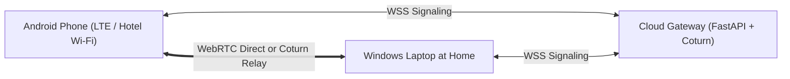

# RemoDesk: Complete Setup, Deployment & Operation Guide

This guide walks through configuring, deploying, running, and troubleshooting the RemoDesk remote desktop system across Windows 10/11 laptops, cloud signaling infrastructure, and Android smartphones.

---

## 1. System Components Summary

| Component | Technology | Role |
| :--- | :--- | :--- |
| **Android Client** | Kotlin, Jetpack Compose, WebRTC Android SDK | User interface, touch/mouse/keyboard controls, video renderer |
| **Windows Host Agent** | C# .NET 8, WinForms, Win32 `SendInput`, DXGI / GDI | Desktop capture, input injection, host tray indicator, file access |
| **Signaling & Auth Gateway** | Python FastAPI, WebSockets, SQLAlchemy, SQLite/PostgreSQL | Device registry, JWT authentication, SDP/ICE candidate routing |
| **Relay Infrastructure** | Coturn STUN/TURN, Docker Compose | RFC 5766 NAT traversal when direct P2P is blocked by symmetric NATs |

---

## 2. Quick Local Start (Testing on One Laptop)

### Step 1: Launch Backend Gateway
Open a terminal in the project directory:
```powershell
.\scripts\run_backend.bat
```
The gateway starts at `http://127.0.0.1:8000`. You can inspect the interactive OpenAPI documentation at `http://127.0.0.1:8000/docs`.

### Step 2: Run the Windows Host Agent
In a second terminal:
```powershell
# Option A: C# .NET 8 Host Agent
.\scripts\run_host_csharp.bat

# Option B: Native Win32 Python Host Agent
.\scripts\run_host_python.bat
```
The Windows Host will connect to `ws://127.0.0.1:8000/ws/signaling`, register your laptop, and show the Host Control window and tray icon.

### Step 3: Run the Android Client
Open `android-client` in Android Studio:
1. Connect your Android phone via USB (with Developer Mode & USB Debugging enabled) or start an Android Emulator.
2. In the app login screen:
   - If using Android Emulator: set Gateway URL to `http://10.0.2.2:8000`.
   - If using a physical phone on the same Wi-Fi: set Gateway URL to `http://<your-laptop-lan-ip>:8000`.
   - If traveling over cellular LTE: set Gateway URL to your public cloud domain (e.g. `https://remodesk.yourdomain.com`).
3. Tap **Create Account**, then **Sign In**.
4. Your laptop will appear on the **Dashboard** with an **Online (Green)** badge.
5. Tap **Connect**!

---

## 3. Remote Access over the Internet (Cellular / Different Wi-Fi)

To control your laptop from anywhere in the world when you travel:



### 1. Deploy the Cloud Gateway & Coturn Relay
Deploy on a cheap VPS (e.g. DigitalOcean, AWS EC2, Hetzner, Linode with Ubuntu 22.04/24.04):
```bash
# Clone the repository onto your server
git clone <your-repo-url> remodesk
cd remodesk/deploy

# Edit turnserver.conf with your server's public IP
# Edit docker-compose.yml with your environment variables

# Start services
docker compose up -d
```

### 2. DNS & HTTPS Configuration
Point your domain (e.g. `remodesk.yourdomain.com`) to your server IP. The provided `deploy/nginx.conf` handles SSL termination and upgrades WebSocket connections automatically.

---

## 4. Touch Controls & Gesture Reference

| Android Gesture | Windows Mouse / Keyboard Action |
| :--- | :--- |
| **Single Tap** | Left mouse click at touch point |
| **Double Tap** | Double left click (opens apps/folders) |
| **Long Press (500ms)** | Right mouse click (context menu with haptic feedback) |
| **Single Finger Drag** | Move mouse cursor or window drag-and-drop |
| **Two-Finger Vertical Drag** | Mouse wheel vertical scroll (webpages & documents) |
| **Two-Finger Horizontal Drag** | Mouse wheel horizontal scroll |
| **Two-Finger Pinch** | Zoom in / Zoom out |
| **Virtual Touchpad Mode** | Relative mouse motion trackpad with dedicated Left & Right click buttons |
| **Special Keys Toolbar** | Windows Key, Ctrl, Alt, Shift, Tab, Esc, Enter, Backspace, Shortcuts |

---

## 5. Security & Privacy Safeguards

1. **Explicit Laptop Owner Authorization**: Incoming sessions can require one-click desktop approval on the laptop before screen streaming begins.
2. **Persistent Visible Status**: When an active session is in progress, the laptop display shows a persistent status indicator in the taskbar tray and title.
3. **Instant Disconnect**: The laptop owner can terminate any remote session instantly with one click.
4. **No Port Forwarding**: The Windows Host Agent makes outbound connections only. No open ports exist on the laptop.
5. **Sandboxed File Operations**: Path traversal (`..`) outside authorized directories (UserProfile, Documents, Downloads, Desktop) is strictly blocked.
